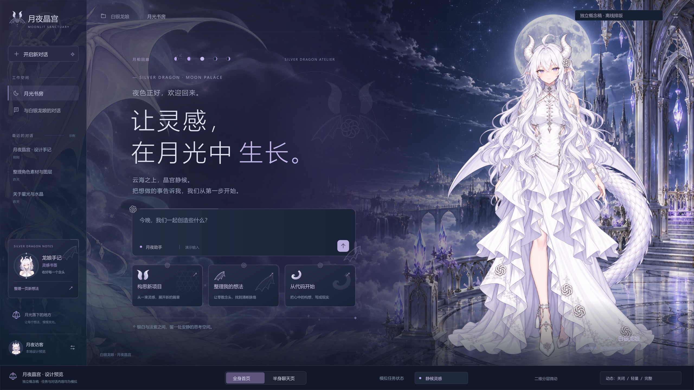
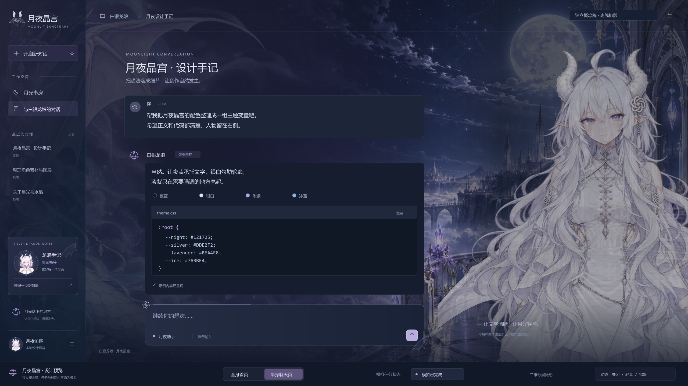

# 白银龙娘 · 月夜晶宫（测试版）

**Codex Dream Silver Dragon · v1.0.0-beta.1**

当前为公开测试版本，功能与兼容性仍在验证，暂不作为稳定版发布。项目提供月夜水晶风格的动态主题组件、透明角色素材、普通静态主题和独立模拟预览。

> 公开内容供查看和下载，未额外授予修改、再分发或商业使用许可。详见 [权利声明](LICENSE-NOTICE.md)。





以上为 **2560×1440 离线概念稿**，内容与任务状态均为模拟，不是应用截图。

## 测试版下载

到 [Releases 下载测试版](https://github.com/liuxiufan1-cell/codex-dream-silver-dragon/releases)。

| 文件 | 内容 |
| --- | --- |
| `codex-dream-silver-dragon-windows-theme-v1.0.0-beta.1.zip` | 源码、素材、已构建动态组件和 Windows 独立预览入口 |
| `codex-dream-silver-dragon-static-v1.0.0-beta.1.zip` | 配置、受限 CSS 和静态背景，严格三个文件 |
| `codex-dream-silver-dragon-source-v1.0.0-beta.1.zip` | 分类源码、素材、概念稿、文档与测试 |
| `SHA256SUMS.txt` / `release-manifest.json` | 下载校验值与发布文件清单 |

Windows 包可启动独立模拟预览。**动态组件仍需兼容宿主集成，测试版暂不提供通用安装器。** 静态 ZIP 可通过兼容第三方引擎导入。包内不含 Codex 应用或完整第三方皮肤引擎。

## 功能

- 首页全身、聊天半身；左侧龙翼、鳞尾纹样与淡紫彩雾。
- 八层透明角色，稳定头脸，局部呼吸、发梢和袖摆微动、翼尾摆动及三态眨眼。
- 关闭 / 轻量 / 完整三档；菜单、滚动、输入法组合和后台时收敛动态。
- 兼容宿主中被动读取当前页面与结构化任务事件；身份无法确认时保持未知。
- 独立 HTML 预览使用明确标注的模拟状态，不调用模型。
- 装饰不截获点击，正文、代码和输入框不跟随角色位移。

## 源码分类

```text
preview/       独立 HTML / CSS / JavaScript 模拟预览
runtime/       动态组件核心与样式；dist/ 由构建生成
assets/art/    背景与龙娘氛围素材
assets/layers/ 透明部件、眨眼补片、坐标和动作清单
assets/ui/     龙角、翼、鳞片、银结等 SVG 装饰
static-theme/  普通静态主题源文件
integration/   实验性宿主集成模板与 ZIP 工具
concepts/      两张定稿概念稿
scripts/       构建、素材导出、发布校验和打包
tests/         惰性 DOM 与虚拟时钟回归
docs/          使用、设计、动作、适配和验证边界
palette.json   配色表
server.mjs     独立预览服务器
```

## 预览与构建

需要 Node.js 20 或更新版本。预览、动态构建、基本测试和打包只使用 Node 内置模块。

```sh
npm run preview
npm run build
npm test
npm run package
```

运行预览后，按终端提示打开浏览器地址。Windows 可双击 `launch-preview.cmd`，或软件包中的 `启动测试预览.cmd`；关闭启动终端即可停止预览。服务器仅监听回环地址。

生成包输出至 `release/v1.0.0-beta.1/`。依赖、构建产物、报告和临时文件不会被提交或再次打进源码包。

重新导出离线概念稿需要图形依赖：

```sh
npm install
npm run render:concepts
```

该命令用 `sharp` 排版 SVG，导出结果不是浏览器截图。系统字体差异可能影响文字排版。

## 说明

- [测试版使用与兼容性](docs/installation.md)
- [素材与配色](docs/assets.md)
- [动作规范](docs/motion-spec.md)
- [动态组件设计](docs/runtime-design.md)
- [路由与任务绑定](docs/runtime-memory-router.md)
- [测试范围与限制](docs/native-acceptance.md)
- [第三方关系](docs/third-party.md)

项目不含设备部署配置、账号、会话、日志、原始参考图或第三方程序。与 OpenAI 无隶属或官方背书关系；第三方作品和商标的权利属于各自权利人。
